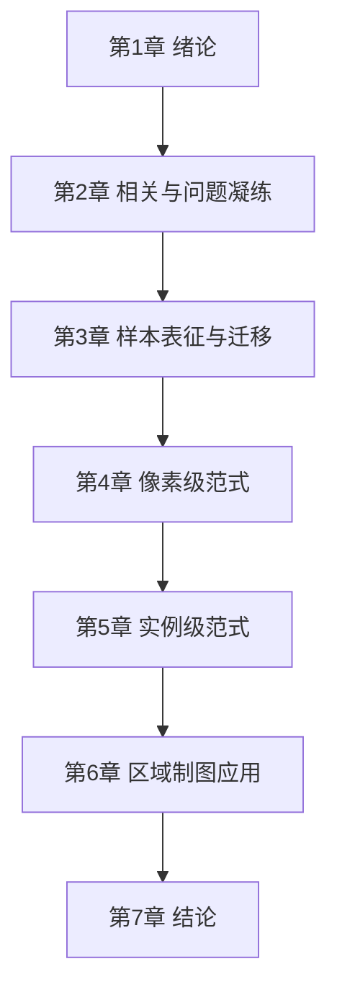
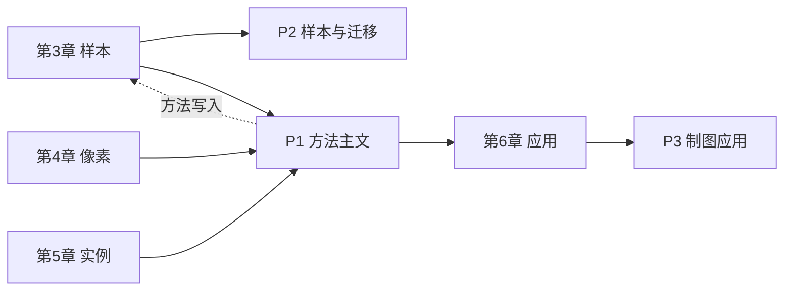

# 博士论文框架（目录 + 贡献点）

**版本**: v0.1  
**用途**: 与贺博/马磊对齐结构；后续可直接扩写开题/大论文目录  
**研究主轴**: 样本失衡 × 场景异构 × 目标–状态耦合条件下的战争损毁层级语义变化检测与区域制图

---

## 题目候选

1. 面向战争损毁的高分辨率遥感层级语义变化检测方法与应用  
2. 样本失衡条件下战争损毁目标的层级变化检测与区域制图  
3. Hierarchical Semantic Change Detection for War Damage Assessment in High-Resolution Remote Sensing

**推荐主标题**: 候选 1（方法 + 应用并列，契合马磊「方法一块、应用一块」）

---

## 总目录

| 章 | 标题 | 角色 |
|----|------|------|
| 第1章 | 绪论 | 问题、意义、结构 |
| 第2章 | 相关研究与问题凝练 | 文献缺口 → 科学问题 |
| 第3章 | 战争损毁样本表征与迁移分析 | 方法块·数据基础（贺博①） |
| 第4章 | 像素级语义变化分析范式 | 方法块·密集预测（贺博②） |
| 第5章 | 实例级损毁解译分析范式 | 方法块·目标解译（贺博③ / HICD 主创新） |
| 第6章 | 区域级战争损毁制图与时序分析 | 应用出口（马磊强调） |
| 第7章 | 结论与展望 | 收束 |

---

## 第1章 绪论

### 目的
从战争损毁遥感监测的国家/公共需求出发，提出「目标类型 + 损毁状态」双重语义变化检测问题，说明为何像素级 CD、通用目标检测、建筑损毁分级均不足以单独回答该问题。

### 主要内容
1. 研究背景与意义（战场毁伤评估、灾后/冲突区客观信息）  
2. 国内外研究现状概述（像素 CD / 实例 CD / 损毁评估 / 数据集）  
3. 现有不足与科学问题凝练  
4. 研究内容、技术路线与论文组织结构  

### 贡献点表述

**中文**  
提出面向战争损毁的层级语义变化检测问题形式化：在高分辨率双时相影像上，同时估计像素级变化场与实例级「目标–损毁状态」联合解译结果，并指认样本长尾、场景异构与标签组合约束为三类核心制约。

**English**  
We formalize hierarchical semantic change detection for war damage assessment: jointly estimating pixel-level change fields and instance-level target–damage-state interpretations from bi-temporal high-resolution images, and identify long-tailed samples, scene heterogeneity, and target–state combinatorial constraints as three core challenges.

---

## 第2章 相关研究与问题凝练

### 目的
用文献把「缺口」钉死：方法链上缺样本科学，范式上像素与实例割裂，应用上缺可清点、可制图的战损产品。

### 主要内容
1. 像素级变化检测（含 SCD、SeK 等协议）  
2. 实例级变化检测与目标损毁评估  
3. 遥感样本构建、类别不平衡与迁移学习  
4. 战争/灾害损毁制图相关工作  
5. 对比分析与本文研究定位（给出「样本–像素–实例–应用」四块定位图）  

### 贡献点表述

**中文**  
系统梳理像素级与实例级变化分析范式的适用边界，指出二者在战争损毁场景下均难单独支撑「可统计、可定位、可解释」的毁伤产品；据此确立「样本表征为前提、双范式协同为方法、区域制图为出口」的研究定位。

**English**  
We systematically delineate the applicability of pixel-level and instance-level change analysis paradigms and argue that neither alone yields statistically accountable, localizable, and interpretable war-damage products. This motivates a research positioning of sample characterization as prerequisite, dual-paradigm collaboration as methodology, and regional damage mapping as the application outlet.

---

## 第3章 战争损毁样本表征与迁移分析

> 对应贺博「样本表征与分析」一章；吸收马磊对样本不平衡、跨城/跨传感器迁移的强调。

### 目的
把数据从「附属材料」提升为一章科学内容：样本分布如何决定方法上限，以及在何种条件下模型可跨城、跨场景复用。

### 主要内容
1. 战争损毁层级标注体系（15 类目标 × 7 类状态）与 0617final 数据集构建  
2. 多场景划分与分布统计（机场 / 港口 / 城乡；22 城）  
3. 长尾与组合稀疏分析（如弹坑、塔台、栈桥；非法 (target, state) 组合）  
4. 面向长尾的样本表征与利用策略（重采样、Copy-Paste、分布感知类权等）  
5. 跨城 / 跨场景迁移可行性实验（可选扩展：跨传感器讨论）  
6. 对后续像素/实例方法的约束与设计启示  

### 贡献点表述

**中文**  
（1）构建面向战争损毁的多城、多场景双时相语义变化样本集，建立目标–状态层级标注与质量控制流程；（2）给出类别–状态联合分布的定量表征，揭示极端长尾与组合稀疏对检测上限的制约；（3）设计并验证分布感知的样本利用与迁移分析框架，说明「何时可跨城复用、何处必须本地适配」。

**English**  
(1) We construct a multi-city, multi-scene bi-temporal semantic change benchmark for war damage with hierarchical target–state annotations and quality control. (2) We provide quantitative characterization of the joint target–state distribution, revealing how extreme long tails and combinatorial sparsity bound detection performance. (3) We design and validate a distribution-aware sample utilization and transfer analysis framework that clarifies when models transfer across cities and where local adaptation is necessary.

---

## 第4章 像素级语义变化分析范式

> 对应贺博「像素级」一章；为第5章实例解译与第6章大范围制图提供密集底图与可扩展推理路径。

### 目的
建立稳健的像素级 target/state 预测路径，作为变化场底图，并讨论小目标与多尺度问题。

### 主要内容
1. 双时相特征提取与时序融合（邻域聚合、多尺度时序融合等）  
2. 频域增强与小目标/边缘敏感表征  
3. 像素级目标头与状态头设计  
4. 训练目标（分割损失、动态权重等）与评估协议（mIoU、SeK、Kappa Changed/Unchanged）  
5. 消融与误差分析（与通用 SCD 基线对比）  

### 贡献点表述

**中文**  
提出面向战损语义变化的像素级分析范式：通过时序融合与频域增强改善多尺度目标与细小损毁线索的密集预测，并在分离变化/未变化评估协议下验证相对通用语义变化检测方法的有效性，为实例级解译提供可靠变化场先验。

**English**  
We propose a pixel-level analysis paradigm for war-damage semantic change: temporal fusion and frequency-domain enhancement improve dense prediction of multi-scale objects and subtle damage cues; under separated changed/unchanged evaluation protocols, the approach outperforms general semantic change baselines and supplies reliable change-field priors for instance-level interpretation.

---

## 第5章 实例级损毁解译分析范式

> 对应贺博「实例级」一章，也是 HICD（层级实例变化检测）主创新章。像素与实例在此章焊成一体。

### 目的
从「哪里变了」进到「哪个目标、何种损毁」：给出可清点、可解释的实例级结果，并显式建模目标与状态的层级约束。

### 主要内容
1. 层级实例变化检测问题定义（target ⊕ state）  
2. 图结构标签空间与合法性约束（可学习 (target, state) 组合）  
3. 层级条件解码（状态预测以目标为条件）  
4. 实例精炼与像素–实例一致性（投票/后处理精炼）  
5. 统一框架下的像素–实例协同推理  
6. 与像素-only、实例-only 变体的对比实验与案例可视化  

### 贡献点表述

**中文**  
（1）提出层级实例变化检测范式，将「目标类别」与「损毁状态」解耦建模并联合解译；（2）设计图结构标签空间与层级条件解码，显式约束非法目标–状态组合，缓解组合空间爆炸；（3）构建像素–实例协同的精炼机制，在实例可清点性与边界/状态一致性上优于单一范式。

**English**  
(1) We propose a hierarchical instance change detection paradigm that decouples yet jointly interprets object category and damage state. (2) We design a graph-structured label space and hierarchical conditional decoding to explicitly constrain invalid target–state combinations and mitigate combinatorial explosion. (3) We develop a pixel–instance collaborative refinement mechanism that improves instance countability and boundary/state consistency over single-paradigm alternatives.

---

## 第6章 区域级战争损毁制图与时序分析

> 对应马磊强调的「应用一块」；从方法论文走向「有图、有清单、有讨论」的产品型章节。

### 目的
在真实冲突区验证可扩展性，形成面向更广受众的损毁制图与时序分析，完成博士论文「方法 + 应用」闭环。

### 主要内容
1. 应用场景与数据组织（优先乌克兰相关城市，如 Mariupol、Bakhmut、Kherson 等，基于已有 22 城样本）  
2. 大范围/大图推理流程（切片–推理–拼接–实例汇总）  
3. 城市级损毁制图产品（目标分布图、损毁状态图、实例清单）  
4. 多时相损毁演化分析（年际/阶段对比）  
5. 与公开损毁产品/文献的定性—半定量对照及误差来源讨论  
6. 对监测业务流程的可操作性讨论（样本更新、跨城部署）  

### 贡献点表述

**中文**  
将层级语义变化检测框架扩展至城市级战争损毁制图：形成「实例清单 + 空间制图 + 时序演化」三位一体的应用表达，并在乌克兰冲突城市案例中验证方法的可扩展性与结果的可解释性，使变化检测研究具备面向决策与公众沟通的输出形态。

**English**  
We extend the hierarchical semantic change detection framework to city-scale war-damage mapping, producing a trinity of instance inventories, spatial damage maps, and temporal evolution analysis. Case studies on conflict-affected Ukrainian cities demonstrate scalability and interpretability, transforming change-detection research into outputs usable for decision support and public communication.

---

## 第7章 结论与展望

### 主要结论（中文提纲）
1. 样本层：战损语义变化的性能上限强烈受目标–状态长尾与跨城异构制约，样本表征是一等公民问题。  
2. 方法层：像素级范式提供可扩展变化场，实例级范式提供可清点解译；层级约束与双范式协同优于单一路径。  
3. 应用层：所提框架可支撑城市级战损制图与时序对比，形成方法研究到应用产品的完整链条。  

### 展望
跨传感器/跨分辨率样本迁移、主动学习式样本更新、更大时空范围（区域至全球）战损制图、与多源情报的融合验证。

### English (summary)
Sample characterization under target–state long tails bounds performance; pixel- and instance-level paradigms are complementary under hierarchical constraints; the integrated framework enables city-scale war-damage mapping and temporal analysis, completing a full chain from methodology to application.

---

## 与两位老师意见的对应关系

| 来源 | 要求 | 本框架落点 |
|------|------|------------|
| 贺博 | 样本表征与分析一章 | 第3章 |
| 贺博 | 像素级范式一章 | 第4章 |
| 贺博 | 实例级范式一章 | 第5章 |
| 马磊 | 不要只抠方法模块，要有大框架 | 全文主轴句 + 四块结构 |
| 马磊 | 样本、迁移、匹配、精度评估要碰 | 第3章（样本/迁移）+ 各章评估节；匹配/一致性进第5章 |
| 马磊 | 方法 + 应用两块足够撑博士 | 第3–5章方法体系 + 第6章应用 |
| 马磊 | 乌克兰/战损制图作为故事出口 | 第6章 |

---

## 建议的技术路线图（写作时用）

1. **问题与数据**（第1–3章）：定义层级战损 CD → 构建/分析样本 → 明确迁移边界  
2. **双范式方法**（第4–5章）：像素变化场 → 实例解译 → 协同精炼  
3. **应用验证**（第6章）：单城深度案例 → 多城扩展 → 时序演化  
4. **收束**（第7章）：贡献回顾与全球尺度展望（不承诺本论文完成全球制图）  

---

## 本论文明确不做的边界（防摊大）

- 不做全球生产级战损数据库与业务系统  
- 不做完整的跨传感器公开基准竞赛式对标（可作讨论/小节）  
- 不把精度评估理论本身扩成独立方法章（协议写入第4/5章实验设计即可）  
- 不追溯实现 V1–V6 全部历史模块；以收敛后的 HICD 统一框架叙述  

---

## 对外沟通用的一句话

> 本博士论文以战争损毁语义变化检测为对象，按「样本表征与迁移 → 像素级变化场 → 实例级目标–状态解译 → 城市级制图与时序分析」组织，方法上形成双范式协同的层级框架，应用上以冲突城市损毁制图为出口。

---

## 小论文支撑安排（约 2.5 年）

> 原则：不必每章一篇；第1–2章靠综述与开题，第3–6章用 **3 篇** 串起来。方法主文优先，样本与应用各一，避免「只堆模块」。

### 论文–章节映射

| 小论文 | 支撑章节 | 定位 | 建议载体（由高到低） | 状态判断 |
|--------|----------|------|----------------------|----------|
| **P1 方法主文** | 第4–5章（主）+ 第3章部分实验 | 层级语义变化检测统一框架：像素场 + 实例 target–state | ISPRS J. / RSE / TGRS / IJAEOG；赶周期可先 GRSL/ICLR-workshop 类 | 以 HICD v7 收敛结果为核心，**优先做** |
| **P2 样本与迁移** | 第3章 | 战损样本集 + 长尾表征 + 跨城/跨场景迁移 | TGRS / IJAEOG / 数据集类期刊；或 Earth System Science Data 风格若强调数据 | 依赖 P1 协议，可与 P1 并行整理数据故事 |
| **P3 应用制图** | 第6章 | 乌克兰（或选定城）时序损毁制图与分析 | RSE / Applied Geography / IJAEOG；偏应用也可 Int. J. Digital Earth 等 | **后置**，等 P1 方法稳定后再铺大图 |

### 不建议的拆法

| 拆法 | 问题 |
|------|------|
| 像素一篇 + 实例一篇完全拆开 | 易显得模块堆叠；马磊会问「故事在哪」；大论文也难焊成一体 |
| 三篇都是小改进方法 | 缺数据/应用出口，博士框架不完整 |
| 先冲应用大图再补方法 | 制图章没有稳定方法支撑，返工成本高 |

### 推荐叙事（写进开题/大论文时）

1. **P1** 回答「怎么检测」：层级双范式方法（大论文方法核心，工作量与创新主载体）。  
2. **P2** 回答「凭什么能检、迁到哪」：样本科学与迁移边界（补足马磊「样本/迁移」）。  
3. **P3** 回答「检出来有什么用」：区域制图与时序（应用出口，受众更广）。

### 两年半时间线（可按开学日平移）

| 阶段 | 时间 | 里程碑 |
|------|------|--------|
| T0–T6 月 | 第 1 学期 | HICD 收敛到可复现主结果；P1 初稿；样本统计与迁移实验设计定稿 |
| T6–T12 月 | 第 2 学期 | **P1 投出**；P2 数据故事+实验主体完成、写作 |
| T12–T18 月 | 第 3 学期 | **P2 投出**；单城大图推理–制图闭环；P3 实验 |
| T18–T24 月 | 第 4 学期 | **P3 投出**；多城/时序扩展；大论文第3–6章成形 |
| T24–T30 月 | 答辩前 | 大论文统稿、预审、答辩；P1–P3 审稿意见对应改写进大论文 |

缓冲：任一篇被拒/大修占 3–4 个月仍够用；**不要三篇并行开写**，串行推进、实验可复用。

### 每篇的「最小可发表故事」模板

**P1**  
- 问题：战损 CD 需要同时输出变化场与可清点实例状态  
- 方法：图标签空间 + 层级条件解码 + 像素–实例协同（频域/时序可作模块消融）  
- 实验：0617final + SECOND/XBD 对照；SeK / 双 mIoU / 实例指标  
- 创新句：Hierarchical target–state change detection with combinatorial label constraints  

**P2**  
- 问题：战损样本极端长尾与跨城异构如何影响 CD  
- 贡献：数据集+分布表征+重采样/类权/迁移协议  
- 实验：跨城 hold-out、消融「样本策略 vs 模型结构」  
- 创新句：Sample characterization and transfer analysis for war-damage SCD  

**P3**  
- 问题：像素/实例结果如何组织成城市级、多时相损毁产品  
- 贡献：推理拼接流程 + 制图与时序分析 + 案例讨论  
- 实验：1 城深度 + N 城扩展；定性/半定量对照  
- 创新句：From change maps to accountable war-damage atlases  

### 与毕业要求对齐时注意

- 先查清学校/学院 **小论文数量、分区、作者位次** 硬性要求，再定 P1 投刊档次。  
- 若只要求 1–2 篇：优先保 **P1（方法）+ P3（应用）** 或 **P1+P2**；P3 更贴马磊「故事出口」，P2 更贴贺博「样本一章」——可与两位老师各对齐一次。  
- 数据集若涉敏：P2/P3 投稿前与导师确认公开策略（可公开统计与制图、不公开原始影像等）。

### 关键创新点总表（写本子/开题/投稿共用）

> 硬性：期刊 2–3 篇 + EI 会议若干；会议与期刊**允许内容重叠**，但创新表述要分层，避免「同一贡献拆太碎」被审稿/学位认定质疑。

| 编号 | 创新点（一句话） | 主要服务 | 落地章节 | 优先期刊 | 可先发 EI |
|------|------------------|----------|----------|----------|-----------|
| **N1** | 目标–状态联合的**图结构标签空间**与合法性约束，压缩非法组合、显式建模层级语义 | 方法核心 | 第5章 | P1 | C2 |
| **N2** | **层级条件解码**：状态预测以目标类别为条件，实现 target→state 联合解译 | 方法核心 | 第5章 | P1 | C2 |
| **N3** | **像素–实例协同**变化分析：像素变化场先验 + 实例精炼，统一输出场与可清点结果 | 方法核心 | 第4–5章 | P1 | C1 |
| **N4** | 面向细小损毁线索的**频域增强**与多尺度时序融合表征 | 方法模块 | 第4章 | P1（消融）/ 可作独立小文 | C1 |
| **N5** | 战争损毁**层级样本集**与目标–状态**联合分布表征**（长尾、组合稀疏、多城异构） | 数据/样本科学 | 第3章 | P2 | C3 |
| **N6** | 分布感知的样本利用策略与**跨城/跨场景迁移**边界分析 | 样本科学 | 第3章 | P2 | C3 |
| **N7** | 从变化检测到**城市级战损制图与时序演化**的应用范式（清单+图+时序） | 应用 | 第6章 | P3 | C4 |

**表述纪律（避免重叠被认定重复）**

- P1 吸收 N1–N4，主句是「**怎么检测**」；不要在 P1 里把数据集当第二贡献写满。  
- P2 吸收 N5–N6，主句是「**样本如何决定上限、能否迁移**」；方法只作分析工具引用 P1。  
- P3 吸收 N7，主句是「**检出来如何形成产品**」；方法压缩为 1 节回顾 + 可复现流程。  
- EI 会议是期刊的**前置/切片**：同一实验库、更窄命题、更快见刊；期刊用「扩展版」声明（扩展 ≥30% 实验/分析，按目标刊要求写 cover letter）。

---

### 分阶段关键创新点（按时间推进）

#### 阶段 A｜方法收敛 + 会议铺垫（约 0–9 月）

**目标产出**
- EI：**C1**（像素/表征向）、**C2**（实例/标签结构向）——可并行或先后 1 个投稿周期  
- 期刊：**P1** 完整稿  

| 论文 | 关键创新点（投稿用 2–3 条） | 必须做出的实验增量 | 与大论文关系 |
|------|------------------------------|--------------------|--------------|
| **C1** EI | ① 双时相多尺度时序融合 + 频域分支增强小目标/边缘损毁线索；② 像素级 target/state 预测在战损 SCD 协议下的有效性 | 频域/时序消融；SECOND 或 0617 像素指标 | 第4章核心实验可复用 |
| **C2** EI | ① 图结构 (target, state) 标签空间；② 层级条件状态解码；③ 相对「独立分类头」基线的组合合法性与实例状态提升 | GNN/条件解码消融；非法组合率、实例状态准确率 | 第5章核心实验可复用 |
| **P1** 期刊 | ① **N3** 统一层级语义变化检测问题与框架（像素场 ⊕ 实例 target–state）；② **N1+N2** 组合约束与层级解码；③ **N4** 作为模块支撑 + 全面对比与误差分析 | 0617final 主表 + 1–2 个公开 CD 数据集；实例+像素双指标；可视化案例 | **第4+5章合并主文**；C1/C2 为其前置 |

**阶段 A 创新句（对外统一口径）**  
> We introduce a hierarchical semantic change detection framework that couples pixel-level change fields with instance-level target–state interpretation via a graph-structured label space and hierarchical conditional decoding.

**阶段 A 完成判据**
- [ ] 主结果可复现（固定 seed/协议）  
- [ ] P1 三贡献与消融表闭环  
- [ ] C1、C2 已投或已录用（任一即可先稳 EI）  

---

#### 阶段 B｜样本科学（约 9–16 月）

**目标产出**
- EI：**C3**（数据集/分布分析短文，若学院认 EI 即可计数）  
- 期刊：**P2**  

| 论文 | 关键创新点 | 必须做出的实验增量 | 与大论文关系 |
|------|------------|--------------------|--------------|
| **C3** EI | ① 多城战损层级标注体系与质检流程；② 目标–状态联合长尾/组合稀疏的定量刻画 | 分布图、稀有类统计、跨城差异表 | 第3章前半 |
| **P2** 期刊 | ① **N5** 战损样本表征科学（不只介绍数据）；② **N6** 分布感知利用 + 跨城/跨场景迁移协议与边界结论；③ 「样本策略 vs 结构改动」对性能贡献的归因分析 | 系统迁移矩阵（城×城）；样本策略消融；与 P1 同 backbone 的受控对比 | **第3章全文**；引用 P1 方法 |

**阶段 B 创新句**  
> We characterize long-tailed target–state distributions in multi-city war-damage SCD and establish transfer boundaries showing when sample strategies dominate architectural changes.

**阶段 B 完成判据**
- [ ] 迁移矩阵结论可写进大论文「样本章」讨论  
- [ ] P2 不重复 P1 的模型创新表述  

---

#### 阶段 C｜应用制图（约 14–22 月）

**目标产出**
- EI：**C4**（单城案例/流程，会议或短文）  
- 期刊：**P3**  

| 论文 | 关键创新点 | 必须做出的实验增量 | 与大论文关系 |
|------|------------|--------------------|--------------|
| **C4** EI | ① 大图切片–推理–拼接–实例汇总流程；② 单城战损制图与时序对比案例 | 1 城端到端跑通；图+清单 | 第6章最小闭环 |
| **P3** 期刊 | ① **N7** 城市级「实例清单 + 空间制图 + 时序演化」应用范式；② 多城/多时相扩展与误差—业务讨论；③ 与公开产品的对照与可操作性（样本更新、跨城部署） | ≥1 城深度 + 若干城扩展；时序至少 2–3 个时间断面 | **第6章全文**；方法节引用 P1 |

**阶段 C 创新句**  
> We scale hierarchical change detection to city-scale war-damage atlases with instance inventories and temporal evolution analysis for conflict-affected regions.

**阶段 C 完成判据**
- [ ] 制图产品可放进学位答辩 PPT  
- [ ] P3 不变成「纯应用报告」：必须保留方法可扩展性与误差科学讨论  

---

#### 阶段 D｜大论文统稿（约 22–30 月）

- 无新小论文硬指标；把 P1–P3 + EI 的实验图/表**按章节重排**，统一符号与协议。  
- 创新点在大论文中重组为 **4 条学位论文贡献**（见下），避免直接粘贴三篇摘要。

**大论文四条贡献（建议目录页写死）**

1. **样本层**：战损层级样本表征与跨城迁移边界（第3章 / P2+C3）  
2. **像素层**：频域与多尺度时序融合的语义变化场（第4章 / P1+C1）  
3. **实例层**：图标签空间 + 层级条件解码的实例损毁解译（第5章 / P1+C2）  
4. **应用层**：城市级战损制图与时序分析范式（第6章 / P3+C4）  

---

### EI 会议清单建议（内容可与期刊重叠）

| 会议文 | 切片内容 | 建议时机 | 扩展去向 |
|--------|----------|----------|----------|
| C1 | 像素表征：时序融合 + 频域 | 阶段 A 早期 | P1 第4章材料 |
| C2 | 实例结构：GNN 标签 + 条件解码 | 阶段 A（可与 C1 错开 1 个会期） | P1 第5章材料 |
| C3 | 数据集/分布/初步跨城 | 阶段 B 初 | P2 |
| C4 | 单城制图案例 | 阶段 C 初 | P3 |

国内 EI 可选方向（按学院认可名单再定）：摄影测量与遥感类学术年会、CVPR/IGARSS 类 workshop 或国内 EI 检索会议；**先查学院「EI 会议是否计入、需否全文 EI 检索」**。

**重叠合规写法**
- 会议 abstract 写清 preliminary / subset；  
- 期刊 introduction 写 “extends our conference papers [C1,C2] by …” 并列出扩展点（统一框架、更多数据集、更全消融、迁移或制图等）；  
- 图表尽量重绘或加实验，不要与会议 PDF 大面积相同图。  

---

### 期刊 2–3 篇的保底组合

| 情形 | 组合 | 说明 |
|------|------|------|
| 最低 2 篇期刊 | **P1 + P2** 或 **P1 + P3** | P1 必保；P2 贴贺博样本章，P3 贴马磊应用故事 |
| 稳妥 3 篇 | **P1 + P2 + P3** | 与当前大论文 3–6 章一一对应，答辩叙事最顺 |
| 冲更高分区 | P1 冲 TGRS/ISPRS/RSE，P2/P3 保 IJAEOG 等 | 先满足数量再冲档次 |

---

### 对老师可以说的三句话

1. 小论文按「方法主文 → 样本与迁移 → 区域制图」三篇推进，分别支撑大论文第4–5、3、6章。  
2. 两年半时间线：约每 6 个月产出/投出一篇，实验与大论文章节同步写。  
3. 希望确认：毕业对小论文的篇数/分区要求，以及 P1 目标期刊档次。

---

---

## 附录 A｜P1 方法主文投稿骨架（优先写）

### Title（候选）

1. **Hierarchical Semantic Change Detection for War Damage Assessment via Graph-Structured Label Space**  
2. Hierarchical Instance–Pixel Change Detection with Combinatorial Target–State Constraints  
3. Coupling Pixel-Level Change Fields and Instance-Level Damage States for High-Resolution War Damage Mapping  

**推荐**: 标题 1（问题域 + 核心机制清晰，贴 N1/N3）

### Abstract（英文，~180–220 词）

> Semantic change detection (SCD) in conflict-affected regions requires more than binary change maps: analysts need to know *which* object changed and *in what damage state*. Existing pixel-level SCD methods produce dense change fields but lack instance accountability, while instance-oriented approaches often ignore the hierarchical coupling between object category and damage state, leading to invalid or semantically inconsistent predictions under combinatorial label spaces. We propose a hierarchical semantic change detection framework that jointly estimates pixel-level target/state fields and instance-level target–state interpretations. A graph-structured label space explicitly models admissible (target, state) combinations, and a hierarchical conditional decoder predicts damage states conditioned on object categories, mitigating combinatorial explosion. Multi-scale temporal fusion and a frequency-domain branch enhance fine-grained damage cues, while pixel–instance collaborative refinement improves countability and boundary/state consistency. Experiments on a multi-city war damage benchmark and public SCD datasets show that the proposed method improves separated change metrics and instance-level state interpretation over strong pixel-only and instance-only baselines. The framework advances accountable change detection for high-resolution remote sensing in humanitarian and security applications.

### Contributions（三条，对应 N 编号）

1. **Problem & framework (N3).** We formalize hierarchical semantic change detection for war damage, unifying pixel-level change fields with instance-level target–state interpretation in a single trainable framework.  
2. **Combinatorial label modeling (N1+N2).** We design a graph-structured label space with validity constraints and a hierarchical conditional decoder that predicts damage states conditioned on object categories, reducing invalid target–state combinations.  
3. **Fine-grained cues & refinement (N4 + N3).** We introduce frequency-enhanced multi-scale temporal features and pixel–instance collaborative refinement, improving small-damage sensitivity and instance countability under long-tailed class distributions.

### Section outline

| Sec. | 内容 | 对应大论文 |
|------|------|------------|
| 1 | Introduction（战损需求 → 双范式缺口） | 第1章压缩 |
| 2 | Related Work：像素 SCD / 实例 CD / 损毁评估 | 第2章压缩 |
| 3 | Method：整体框架 → 图标签空间 → 条件解码 → 像素支路 → 协同精炼 → 损失 | 第4–5章 |
| 4 | Experiments：数据、协议、主表、消融、可视化 | 第3章统计 + 第4–5章 |
| 5 | Discussion / Limitations（长尾、跨城、计算量） | 与 P2 衔接 |
| 6 | Conclusion | — |

### 必做实验矩阵（P1）

| 类型 | 内容 | 服务贡献 |
|------|------|----------|
| 主表 | 0617final：Target mIoU / State mIoU / SeK / Kappa_chg / Kappa_unch | 全文 |
| 对照数据集 | SECOND、XBD（或其一）统一协议 | 泛化 |
| 基线 | 像素 SCD（如 BIT/CHANGEformer 类）、实例/检测 CD、像素-only 本模型、实例-only 本模型 | N3 |
| 消融 A | 去掉图标签空间 / 去掉条件解码 → 非法组合率、State mIoU | N1 N2 |
| 消融 B | 去掉频域、去掉 NFA/TFM | N4 |
| 消融 C | 去掉像素–实例精炼 → 实例数误差、边界指标 | N3 |
| 分析 | 长尾类（弹坑/塔台等）逐类 IoU；失败案例 | 呼应 P2 |
| 可视化 | 变化场 + 实例框/清单 + 状态着色 | 答辩/PPT 同源 |

### Related Work 三分法（写作提纲）

1. **Pixel-level SCD**：密集标签、SeK 协议；局限——无实例身份。  
2. **Instance-level change / damage assessment**：检测或建筑分级；局限——弱化目标–状态组合语义、难出大范围场。  
3. **Label structure & hierarchical classification**：组合标签、条件分类；本文将其引入战损 SCD 并与双范式耦合。

### 与会议文衔接句（Introduction 末）

> Parts of this work appeared in preliminary form in [C1, C2]. This journal version presents the unified hierarchical framework, comprehensive ablations, additional benchmarks, and instance–pixel analysis not covered in the conference papers.

---

## 附录 B｜P2 样本与迁移投稿骨架

### Title

1. **Sample Characterization and Cross-City Transfer for War-Damage Semantic Change Detection**  
2. Long-Tailed Target–State Distributions and Transfer Boundaries in Multi-City Conflict Damage Mapping  

### Abstract（英文）

> Performance of semantic change detection in war-affected areas is often limited less by decoder design than by sample long tails, sparse target–state combinations, and scene heterogeneity across cities. We present a systematic study of sample representation and transfer for war-damage SCD. Building on a multi-city bi-temporal benchmark with hierarchical object–damage labels, we quantify joint target–state distributions, reveal extreme sparsity of rare damage classes, and evaluate distribution-aware sample utilization strategies against architectural modifications under a controlled backbone. Cross-city hold-out experiments establish transfer boundaries: we identify when models trained in one theater remain effective in another and where local adaptation or targeted resampling is necessary. Results indicate that sample strategies frequently dominate incremental network changes for rare states, reframing dataset design as a first-class scientific problem for accountable conflict remote sensing.

### Contributions

1. **N5** Multi-city hierarchical war-damage sample benchmark + quantitative joint distribution characterization (long tail, combinatorial sparsity).  
2. **N6** Distribution-aware utilization (resampling / copy-paste / class-balancing) with controlled comparison to structure-only changes.  
3. **Transfer protocol & boundaries** Cross-city (and optional cross-scene) hold-out matrix with actionable guidance for theater-level deployment.

### 与 P1 的边界句

> We adopt the hierarchical SCD model in [P1] as a fixed analysis tool and do not claim new architectural contributions; the focus is on how samples and transfer shape attainable accuracy.

---

## 附录 C｜P3 应用制图投稿骨架

### Title

1. **From Change Maps to City-Scale War Damage Atlases: Hierarchical Instance Inventory and Temporal Evolution Analysis**  
2. Multi-Temporal War Damage Mapping with Hierarchical Semantic Change Detection: A Case Study in Conflict-Affected Cities  

### Abstract（英文）

> Change detection research often stops at accuracy tables, leaving a gap between maps and usable damage products. We scale a hierarchical semantic change detection framework to city-scale war damage mapping, producing instance inventories, spatial damage maps, and multi-temporal evolution analysis for conflict-affected urban areas. A tiled inference–mosaic–inventory pipeline enables large-scene processing; case studies demonstrate how target-level damage states aggregate into interpretable spatial statistics and year-over-year dynamics. We discuss error propagation, comparison with available open damage assessments, and operational considerations for sample refresh and cross-city deployment. The study illustrates an application pathway that turns hierarchical change detection into accountable geospatial products for broader analytical audiences.

### Contributions

1. **N7** Application paradigm: instance inventory + damage cartography + temporal evolution as a coupled product.  
2. **Scalable inference pipeline** for large scenes with hierarchical SCD models.  
3. **Case-based evaluation** linking pixel/instance metrics to map-level interpretability and operational use.

### 与 P1/P2 边界

> Methodological details follow [P1]; sample and transfer constraints are analyzed in [P2]. This paper emphasizes productization, scale, and temporal analysis.

---

## 附录 D｜EI 会议文一页纸规格

| ID | Title 草案 | 核心创新 | 图表最小集 | 扩展声明 |
|----|------------|----------|------------|----------|
| **C1** | Frequency-Enhanced Temporal Fusion for Pixel-Level War Damage Change Detection | N4 + 像素头 | 框架图、频域消融、像素指标表 | → P1 Sec.3–4 |
| **C2** | Graph-Structured Label Space for Instance-Level Damage State Change Detection | N1+N2 | 图标签示意、条件解码、非法组合率 | → P1 Sec.3,5 |
| **C3** | A Multi-City Hierarchical Benchmark for War Damage Semantic Change | N5 前半 | 分布图、场景表、长尾条形图 | → P2 |
| **C4** | City-Scale Damage Mapping with Hierarchical Change Detection: A Case Study | N7 最小闭环 | 制图流程、单城成果图、清单样例 | → P3 |

**会议 Abstract 模板（英文，~100 词）**  
> This paper presents a preliminary study on [topic]. We [method one-liner, cite N#]. On [dataset/city], results show [1–2 quantitative or qualitative findings]. This work is a subset of an ongoing journal submission on [P#]; extended experiments will appear there.

---

## 附录 E｜写作与对齐检查清单

### 投 P1 前

- [ ] 主表数字与 `README`/日志可对上，协议写死（划分、分辨率、指标定义）  
- [ ] 三条 Contribution 与消融表一一对应，无「第 0.5 条」发明点  
- [ ] 明确相对 C1/C2 的扩展点 ≥3 项  
- [ ] 长尾类失败案例单独讨论（给 P2 留钩子）  
- [ ] 作者序、单位、基金与贺博/马磊确认  

### 投 P2 前

- [ ] 与 P1 同一 backbone/训练配方（受控）  
- [ ] 迁移矩阵完整（城×城），结论可写进大论文讨论  
- [ ] 数据公开策略已确认（统计/标签可公开到什么程度）  

### 投 P3 前

- [ ] 至少 1 城端到端产品图可复现  
- [ ] 时相 ≥2（最好 3）断面  
- [ ] 方法节压缩，避免与 P1 重复率过高  

### 给马磊的进度句式（按阶段）

| 阶段 | 一句话汇报 |
|------|------------|
| A 初 | 本周收敛 HICD 主表，P1 三贡献已与消融对齐；C1/C2 拟作 EI 前置。 |
| A 末 | P1 初稿完成/已投 X 刊；主结果与会议文扩展关系已写清。 |
| B | 跨城迁移矩阵完成：Y 城可迁、Z 城需本地样本；P2 按此写讨论。 |
| C | 单城制图闭环已出图与时序对比，拟投 P3；方法只引用 P1。 |

### 给贺博的结构确认句

> 小论文：P1 方法（支撑第4–5章）、P2 样本与迁移（第3章）、P3 制图应用（第6章）；EI 会议 C1–C4 作前置切片，内容允许重叠但创新分层。请确认样本章是否还需单独强调跨传感器一节。

---

## 下一步可选产出

- [ ] 压缩成「1 页纸」版本（给马磊周会/邮件）  
- [ ] 每章 800–1200 字开题级扩写  
- [ ] 第6章最小实验设计（选 1 城打通推理–制图闭环）  
- [x] 英文 Abstract + Contribution bullets（P1–P3，见附录 A–C）  
- [x] P1 投稿用 Contribution 列表与 Related Work 骨架（见附录 A）  
- [ ] P1 LaTeX 章节草稿（Method 一节可从 HICD_v7 模块图起草）  
- [ ] C1/C2 会议全文提纲（各 6–8 页）  
